# An Interpretable Pipeline for Imbalanced Industrial Anomaly Detection

**VAE-GAN Augmentation · CatBoost Classification · TreeSHAP Interpretation**

[](https://www.python.org/)
[](https://www.tensorflow.org/)
[](https://catboost.ai/)
[](https://github.com/shap/shap)
[](https://fastapi.tiangolo.com/)
[](LICENSE)

Code for the MSc Robotics dissertation by **Dong-Jun Chen**,
University of Bristol & University of the West of England, August 2025.
📄 **[Read the dissertation (PDF)](docs/dissertation.pdf)**

Anomalous wafers make up only about 6% of the UCI-SECOM semiconductor dataset, and
supervised detectors trained on it hardly ever see a defect. Black-box detectors are also hard
for process engineers to trust. This project builds one **end-to-end, interpretable pipeline**
that:

1. **reduces** 590 noisy sensor features to a compact, informative subset,
2. **generates realistic synthetic anomalies** with a **VAE-GAN** (vanilla VAE as baseline) to rebalance the classes,
3. **detects** anomalies with a Bayesian-optimised **CatBoost** classifier,
4. **explains** every detection with **TreeSHAP**, globally and per instance, and
5. **serves** the model through a **FastAPI** endpoint that scores streamed raw records in real time.

<p align="center">
  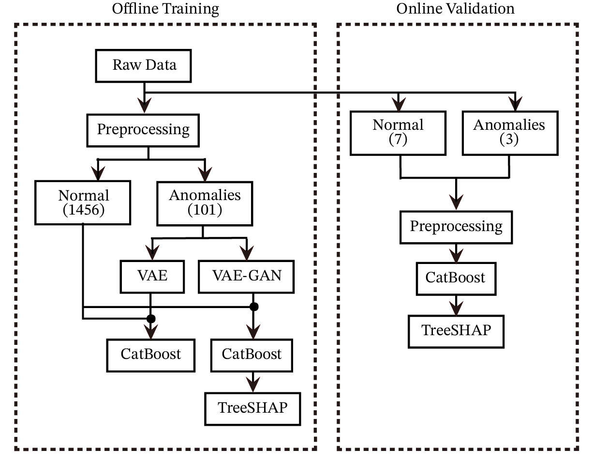
</p>

---

## Contents

- [Highlights](#highlights)
- [Research aims](#research-aims)
- [Dataset](#dataset)
- [Method](#method)
- [Results](#results)
- [Repository structure](#repository-structure)
- [Getting started](#getting-started)
- [Real-time API](#real-time-api)
- [Implementation notes](#implementation-notes)
- [Limitations and future work](#limitations-and-future-work)
- [Citation](#citation)
- [License and acknowledgements](#license-and-acknowledgements)

---

## Highlights

| | |
|---|---|
| **Feature reduction** | 590 → 33 sensor features (a 94.4% reduction) through EDA-driven filtering |
| **Generation quality** | VAE-GAN anomalies are closer to the real anomalies than VAE anomalies on **all four** distance metrics (KL, JS, Wasserstein, MMD) |
| **Detection** | VAE-GAN + CatBoost: **Precision 0.988 · Recall 0.953 · F1 0.970 · ROC-AUC 0.985 · PR-AUC 0.989**, ahead of prior SMOTE-based tree models on UCI-SECOM |
| **Interpretability** | TreeSHAP bar, beeswarm and waterfall plots; feature **511** has the largest mean impact |
| **Deployment** | Online simulation with 10 held-out raw records: all 7 normal records pass, 2 of 3 anomalies are flagged and explained automatically |

## Research aims

| # | Aim | How it is evaluated |
|---|-----|---------------------|
| 1 | Identify the critical features in high-dimensional sensor data | EDA: missing values, variance, label correlation, collinearity |
| 2 | Verify that VAE-GAN captures the real anomaly distribution better than a VAE | KL / JS divergence, Wasserstein distance, MMD, KDE & KernelPCA plots |
| 3 | Quantify how synthetic-data quality affects detection | Precision, Recall, F1, ROC-AUC, PR-AUC, confusion matrix |
| 4 | Find the best oversampling ratio | CatBoost trained with 0%, 30%, 50%, 80%, 100% synthetic anomalies |
| 5 | Provide global and local explanations | TreeSHAP bar, beeswarm and waterfall plots |
| 6 | Validate online detection | Raw records streamed to a FastAPI service |

## Dataset

[**UCI-SECOM**](https://archive.ics.uci.edu/dataset/179/secom) ([Kaggle mirror](https://www.kaggle.com/datasets/paresh2047/uci-semcom)) contains
**1,567** production records from a semiconductor manufacturing line. Each record has **590** sensor
measurements, a timestamp and a `Pass/Fail` label (`-1` = pass/normal, `1` = fail/anomaly).
Only **104** records (≈ 6.6%) are anomalies, and many features are constant, sparse or highly collinear.

The raw file is included at [`data/raw/uci-secom.csv`](data/raw/uci-secom.csv). The dataset is
published by the UCI Machine Learning Repository under CC BY 4.0.

<p align="center">
  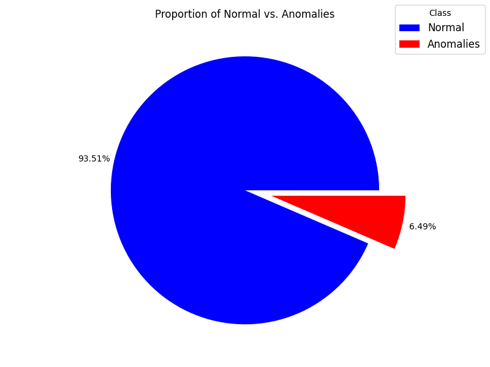
  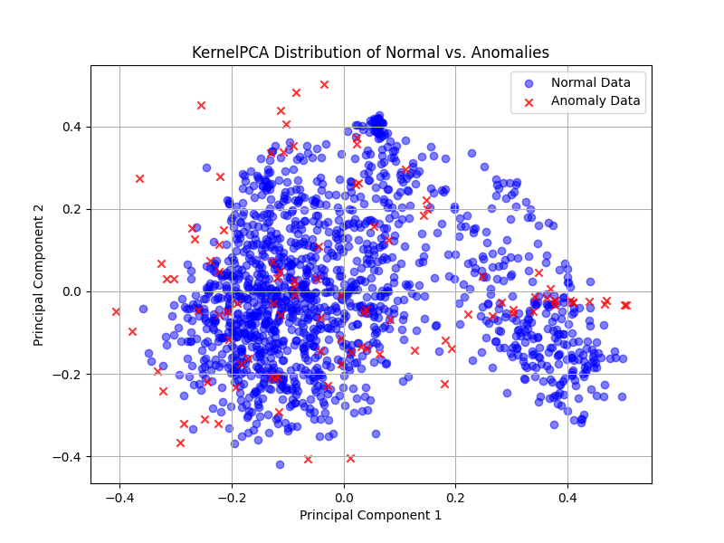
</p>

The KernelPCA projection (right) shows that normal and anomalous records overlap heavily. That
breaks the main assumption of unsupervised detectors, which is why this work uses a **supervised**
detector combined with data augmentation.

## Method

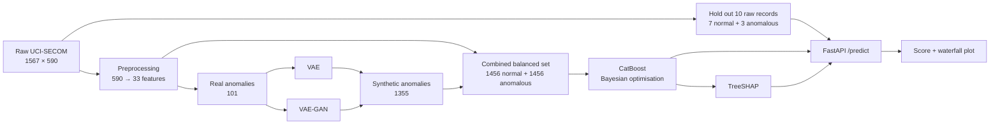

### 1. Preprocessing (`scripts/01_preprocess.py`)

Before any cleaning, 10 raw records (7 normal, 3 anomalous) are held out for the online validation.
The rest goes through the following steps:

| Step | Rule |
|------|------|
| Hold out raw records | 7 normal + 3 anomalous kept aside |
| Drop timestamp | |
| Missing values | drop features with > 20% missing, mean-impute the rest |
| Constant features | drop features with a single unique value |
| Low variance | drop features with variance < 0.05 |
| Label correlation | drop features with \|Pearson r\| < 0.05 with the label |
| Collinearity | for each pair with \|r\| ≥ 0.75, keep only the most informative feature |
| Standardisation | z-score, with the scaler fitted on normal records only |

The feature dimensionality drops from **590 to 33 (a 94.4% reduction)**.

The fitted scaler and the indices of the kept features are saved in `artifacts/preprocessing/`, so the
API applies exactly the same transformation to a raw 590-value record.

### 2. Synthetic anomaly generation (`scripts/02_generate_anomalies.py`)

Both generators are trained **only on the 101 real anomalies** and share the same architecture, so any
difference in output comes from the training objective alone:

- **Encoder**: Dense 512 → 256 → 128 → 64 → 32 (ReLU, BatchNorm, L2) → (μ, log σ²)
- **Decoder / generator**: the mirror image, with a linear output layer
- **Discriminator** (VAE-GAN only): Dense 512 → 256 → 128 → 64 → 32 → sigmoid

**VAE** ([`models/vae.py`](src/anomaly_detection/models/vae.py)) minimises the β-weighted negative ELBO:

$$\mathcal{L}_{VAE} = \beta \, D_{KL}\big(q(z\mid x)\,\|\,p(z)\big) + \mathcal{L}_{recon}$$

**VAE-GAN** ([`models/vaegan.py`](src/anomaly_detection/models/vaegan.py), Larsen et al. 2016)
replaces the pixel-wise reconstruction loss with a **feature-matching loss** on an intermediate
discriminator layer, which counteracts the over-smoothing (“blurring”) of a VAE. Encoder, generator
and discriminator are each trained with their own optimiser:

$$\mathcal{L}_{Enc} = \beta\,\mathcal{L}_{prior} + \mathcal{L}^{Dis_l}_{recon}, \qquad
\mathcal{L}_{Gen} = \gamma\,\mathcal{L}^{Dis_l}_{recon} - \mathcal{L}_{GAN}, \qquad
\mathcal{L}_{Dis} = \mathcal{L}_{GAN}$$

$$\mathcal{L}_{GAN} = \log D(x) + \log\big(1 - D(\tilde{x})\big) + \log\big(1 - D(G(z))\big)$$

where $\tilde{x}$ is a reconstruction and $G(z)$ is a sample decoded from the prior. By default, enough
anomalies are generated to balance the two classes (1,355 samples); `--ratio` scales that number.

### 3. Generation quality (`scripts/03_evaluate_generation.py`)

Real and generated anomalies are compared feature by feature with four complementary distances:
**KL divergence** and **JS divergence** (probability mass, histogram-based), plus **Wasserstein
distance** and **MMD** with an RBF kernel (geometry and feature-space structure). Lower values mean
the generated anomalies are closer to the real ones.

### 4. CatBoost detector (`scripts/04_train_catboost.py`)

The combined dataset is split 80/20 into training and test sets. CatBoost uses **ordered boosting**, which
avoids target leakage, with `Logloss` as the loss and F1 as the evaluation metric. The
hyperparameters were selected by **Bayesian optimisation** (Gaussian-process `gp_minimize`),
which maximises the mean 5-fold stratified cross-validated F1:

$$\theta^{*} = \arg\min_{\theta} \; -\frac{1}{5}\sum_{k=1}^{5} F1_k(\theta)$$

| max_depth | iterations | learning_rate | l2_leaf_reg | min_data_in_leaf |
|---:|---:|---:|---:|---:|
| 4 | 73 | 0.1 | 12 | 6 |

These values (dissertation Table II) are the defaults in `config.py`; `--tune` re-runs the search.
Scores ≥ 0.5 are classified as anomalies.

### 5. TreeSHAP explanations (`--shap`)

TreeSHAP computes exact Shapley values for tree ensembles in $O(TLD^2)$ instead of $O(2^M)$.
The background set contains **1,000 normal training records**, so each attribution measures how far
a record deviates from normal behaviour. Bar and beeswarm plots give the global picture, and a
waterfall plot explains a single detection.

### 6. Online validation (`scripts/06_serve_api.py`)

A FastAPI service loads the model, the preprocessing artifacts and the SHAP explainer. The 10
held-out **raw** records are streamed to `/predict` one by one. Each record goes through the same
preprocessing and is scored by CatBoost. When it is flagged, a waterfall plot is rendered for
the domain expert.

## Results

All numbers and figures in this section are those reported in the [dissertation](docs/dissertation.pdf).

### Generated anomaly quality

| VAE (baseline) | VAE-GAN |
|:---:|:---:|
| 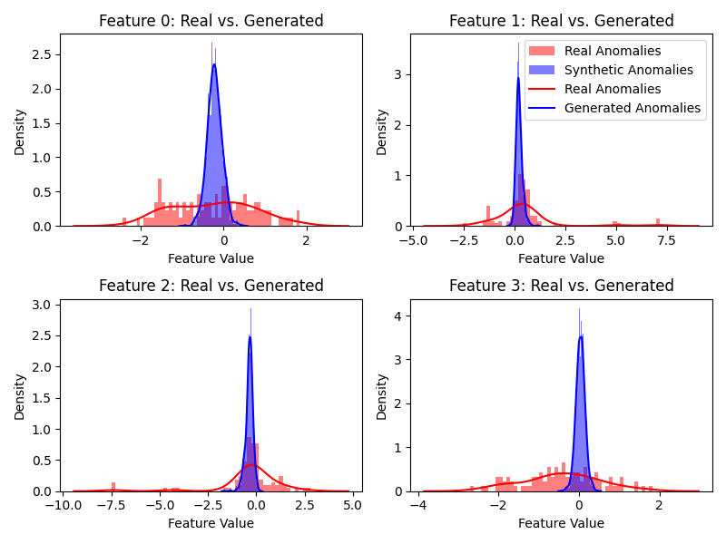 | 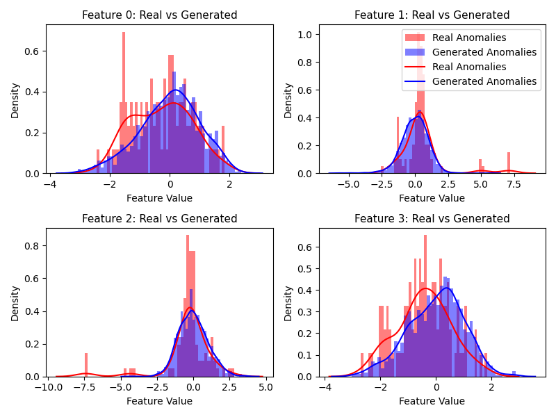 |
| 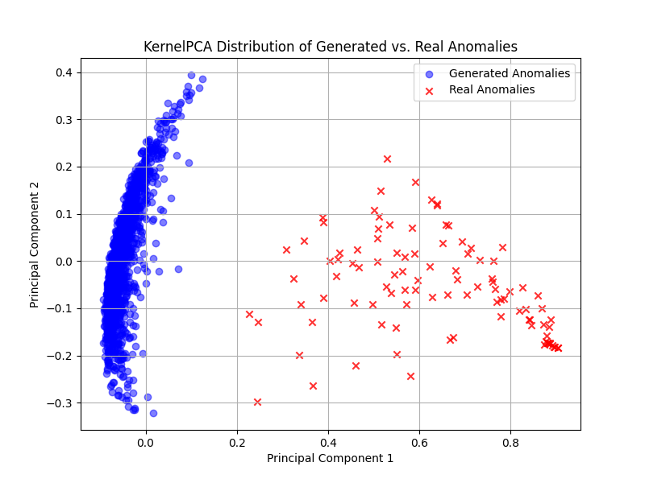 | 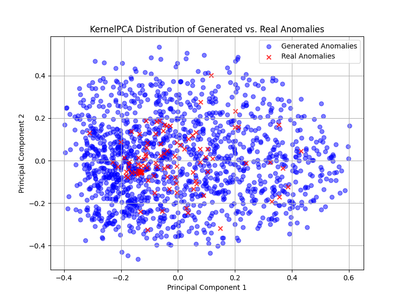 |

VAE samples collapse into a narrow peak and cover only a small corner of the real anomalies in
KernelPCA space. VAE-GAN samples follow the real distributions much more closely.

| Total distance over all features ↓ | VAE | VAE-GAN |
|---|---:|---:|
| KL divergence | 433.655 | **26.756** |
| JS divergence | 13.051 | **4.046** |
| Wasserstein distance | 21.401 | **12.457** |
| MMD | 10.466 | **4.975** |

### Detection performance

| Model | Precision | Recall | F1 | ROC-AUC | PR-AUC |
|---|---:|---:|---:|---:|---:|
| SMOTE + DT (prior study) | 0.869 | 0.958 | 0.911 | – | – |
| SMOTE + AdaBoost (prior study) | 0.919 | 0.926 | 0.965 | – | – |
| SMOTE + GBT (prior study) | 0.968 | 0.958 | 0.963 | – | – |
| SMOTE + XGB (prior study) | 0.975 | 0.958 | 0.966 | – | – |
| VAE + CatBoost (baseline) | 0.981 | 0.949 | 0.965 | **0.986** | **0.989** |
| **VAE-GAN + CatBoost (proposed)** | **0.988** | 0.953 | **0.970** | 0.985 | **0.989** |

| VAE + CatBoost | VAE-GAN + CatBoost |
|:---:|:---:|
|  | 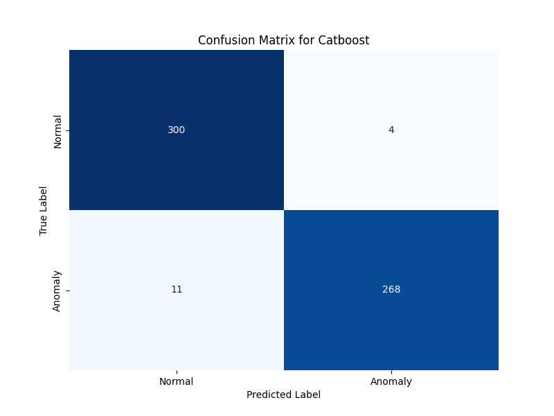 |

With VAE-GAN augmentation, CatBoost makes fewer false negatives (11 vs 14) and fewer false
positives (4 vs 5).

### Oversampling ratio

| OS ratio | Precision | Recall | F1 | ROC-AUC | PR-AUC |
|---|---:|---:|---:|---:|---:|
| 0% | 0.000 | 0.000 | 0.000 | 0.740 | 0.130 |
| 30% | 0.964 | 0.788 | 0.867 | 0.922 | 0.904 |
| 50% | 0.984 | 0.871 | 0.924 | 0.922 | 0.962 |
| 80% | 0.986 | 0.939 | 0.962 | 0.974 | 0.980 |
| **100%** | **0.988** | **0.953** | **0.970** | **0.985** | **0.988** |

Without augmentation CatBoost never predicts an anomaly. Performance rises steeply with the
oversampling ratio, and 80% is already close to the fully balanced 100%. The raw numbers are stored in
[`results/`](results/).

### Interpretability

| Global feature importance | Feature value vs. SHAP value |
|:---:|:---:|
| 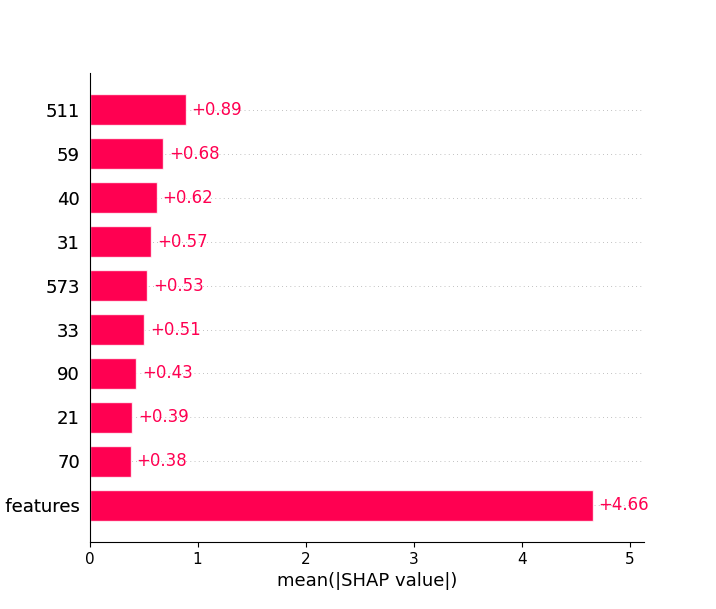 | 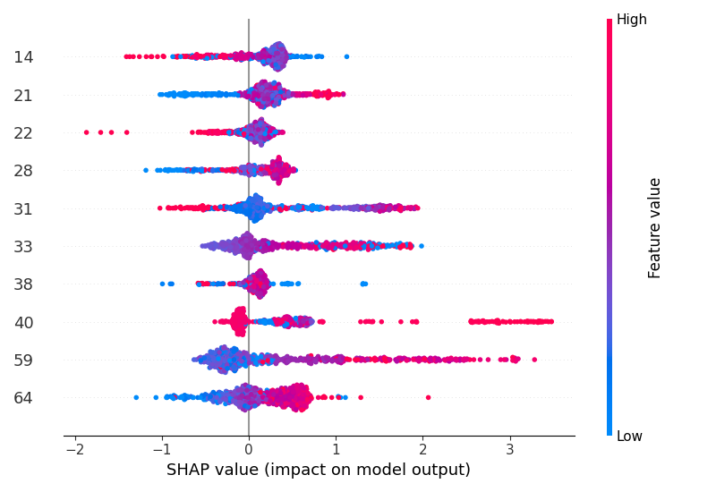 |

- Feature **511** has the largest mean |SHAP|, followed by 59 and 40.
- The beeswarm plot shows *how* a feature pushes towards an anomaly. For example, low values of
  feature 14 or high values of feature 21 increase the anomaly score.

<p align="center">
  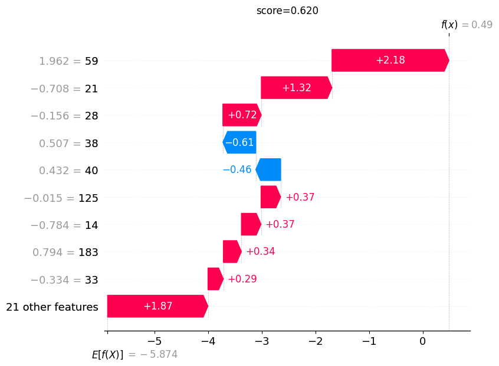
</p>

During the online simulation, the waterfall plot above explains a streamed anomaly (score 0.620).
Feature 59 (value 1.962) contributes the most, which is consistent with the beeswarm plot.

## Repository structure

```
.
├── data/
│   ├── raw/uci-secom.csv                 # original dataset
│   ├── processed/                        # cleaned, standardised data + real anomalies
│   ├── streaming/test_data.csv           # 10 held-out raw records for the API demo
│   └── synthetic/                        # generated anomalies and combined training sets
├── artifacts/
│   ├── preprocessing/                    # scaler.pkl, all_cols.npy, idx.npy
│   └── model/                            # model.cbm, threshold.npy, bg_1000.npy (online-validation model)
├── src/anomaly_detection/
│   ├── config.py                         # all paths and hyperparameters
│   ├── preprocessing.py                  # cleaning pipeline + online transform()
│   ├── models/vae.py                     # VAE generator
│   ├── models/vaegan.py                  # VAE-GAN (encoder, decoder, discriminator)
│   ├── generation.py                     # train a generator and sample anomalies
│   ├── distance_metrics.py               # KL, JS, Wasserstein, MMD
│   ├── classifier.py                     # CatBoost training, Bayesian search, evaluation
│   ├── explain.py                        # TreeSHAP
│   ├── visualization.py                  # every plot (saved to outputs/figures/)
│   └── api.py                            # FastAPI service
├── scripts/                              # numbered entry points, run in order
│   ├── 01_preprocess.py
│   ├── 02_generate_anomalies.py
│   ├── 03_evaluate_generation.py
│   ├── 04_train_catboost.py
│   ├── 05_plot_oversampling.py
│   └── 06_serve_api.py
├── results/                              # numbers reported in the dissertation (CSV)
├── docs/                                 # dissertation PDF and figures
├── tests/                                # smoke tests
├── requirements.txt
└── pyproject.toml
```

Running the scripts creates an `outputs/` folder (git-ignored) holding figures, metrics and API plots.

## Getting started

### Installation

```bash
git clone https://github.com/JimCH123/Interpretable_Anomaly_Detection_VAEGAN_Catboost.git
cd Interpretable_Anomaly_Detection_VAEGAN_Catboost

python -m venv .venv
source .venv/bin/activate        # Windows: .venv\Scripts\activate

pip install -r requirements.txt
pip install -e .                 # makes the anomaly_detection package importable
pytest                           # optional: smoke tests (~30 s)
```

The pinned versions were tested with Python 3.11 on CPU.

### Try the trained model in one command

Processed data, synthetic data and the trained model are committed, so the API demo works
right after installation:

```bash
python scripts/06_serve_api.py
```

### Run the full pipeline

| Step | Command | Output |
|------|---------|--------|
| 1. Preprocess | `python scripts/01_preprocess.py` | `data/processed/`, `data/streaming/`, `artifacts/preprocessing/`, EDA figures |
| 2. Generate anomalies | `python scripts/02_generate_anomalies.py --model vae`<br>`python scripts/02_generate_anomalies.py --model vaegan` | `data/synthetic/`, KDE & KernelPCA figures |
| 3. Generation quality | `python scripts/03_evaluate_generation.py` | distance table, comparison figure |
| 4. Detect & explain | `python scripts/04_train_catboost.py --model vae`<br>`python scripts/04_train_catboost.py --model vaegan --shap --save-model` | metrics, confusion matrix, ROC/PR curves, SHAP figures, `artifacts/model/` |
| 5. Oversampling plot | `python scripts/05_plot_oversampling.py` | oversampling-ratio figure |
| 6. Online validation | `python scripts/06_serve_api.py` | live predictions, `outputs/api_plots/` |

Useful options (run any script with `--help` to see all of them):

| Option | Script | Effect |
|--------|--------|--------|
| `--show` | all | also open each figure in a window (figures are always saved to `outputs/figures/`) |
| `--ratio 0.3` | 02, 04 | oversampling ratio; files get an `_r0.3` suffix |
| `--epochs N` | 02 | override the number of training epochs |
| `--fix-adversarial` | 02 | let the adversarial loss update the VAE-GAN decoder (see [Implementation notes](#implementation-notes)) |
| `--tune` | 04 | run the Bayesian hyperparameter search and train with the best parameters |
| `--shap` | 04 | produce the TreeSHAP figures |
| `--save-model` | 04 | overwrite `artifacts/model/`, the model used by the API |

To reproduce one row of the oversampling experiment:

```bash
python scripts/02_generate_anomalies.py --model vaegan --ratio 0.3
python scripts/04_train_catboost.py     --model vaegan --ratio 0.3
```

All hyperparameters live in [`src/anomaly_detection/config.py`](src/anomaly_detection/config.py).

## Real-time API

```bash
python scripts/06_serve_api.py                 # serve + stream the 10 held-out records
python scripts/06_serve_api.py --no-stream     # serve only
# or: uvicorn anomaly_detection.api:app --port 8000
```

| Endpoint | Description |
|----------|-------------|
| `GET /health` | liveness check |
| `POST /predict` | body `{"line": "<590 comma-separated raw values>"}` (empty fields are allowed) → `{"score": float, "is_anomaly": bool, "plot_file": str \| null}` |
| `GET /plot/{file}` | the SHAP waterfall PNG of a detected anomaly |

Interactive docs are available at `http://127.0.0.1:8000/docs`. Example client:

```python
import pandas as pd, requests

row = pd.read_csv("data/streaming/test_data.csv").iloc[-1]          # an anomalous record
line = ",".join("" if pd.isna(v) else str(v) for v in row.drop(["Pass/Fail", "Time"]))
print(requests.post("http://127.0.0.1:8000/predict", json={"line": line}).json())
```

Output of the streaming simulation with the committed model:

```
Record 0..6 (true label: normal)  -> is_anomaly: False   (scores 0.0005 – 0.084)
Record 7    (true label: anomaly) -> score 0.620, is_anomaly: True,  plot_file: <timestamp>.png
Record 8    (true label: anomaly) -> score 0.516, is_anomaly: True,  plot_file: <timestamp>.png
Record 9    (true label: anomaly) -> score 0.014, is_anomaly: False
```

## Implementation notes

The code keeps the exact behaviour that produced the committed artifacts. The points below are worth
knowing when you read or extend it:

- **Generator hyperparameters.** `config.py` holds the values used to train the committed
  generators. They differ from Table I of the dissertation:

  | Parameter | `config.py` | Dissertation (Table I) |
  |---|---|---|
  | VAE β | 0.01 | 0.1 |
  | VAE-GAN β / γ | 1 / 1 | 0.1 / 2 |

- **CatBoost hyperparameters.** `config.py` uses the Table II values. The committed
  `artifacts/model/model.cbm` is the model used for the dissertation's online validation and was
  trained with `max_depth=3, iterations=500, learning_rate=0.5, l2_leaf_reg=1, min_data_in_leaf=10,
  scale_pos_weight=3`. `04_train_catboost.py --save-model` replaces it with a Table II model.

- **VAE-GAN decoder update.** In the original training step, the decoder loss reuses the
  discriminator outputs computed before the decoder's gradient tape. As a result, the
  $-\mathcal{L}_{GAN}$ term contributes no gradient, and the decoder is trained through the
  feature-matching loss only. This is kept as the default for reproducibility.
  `--fix-adversarial` recomputes those outputs inside the tape so that the full Eq. 9 applies.
- **VAE-GAN output scaling.** `VAEGAN.generate()` z-scores each generated feature; `VAEGenerator.generate()` does not.
- **CatBoost early stopping.** The final model is fitted without an evaluation set, so
  `early_stopping_rounds` has no effect and all iterations are trained. During the Bayesian search,
  the early-stopping set is a subset of the training fold.
- **Missing values online.** `transform()` fills missing raw values with 0 before scaling, while
  the offline pipeline mean-imputes them.
- **Randomness.** Generation is stochastic. The scripts now set a seed (`--seed`), but the committed
  `data/synthetic/` files and `model.cbm` come from the original experiments. Re-running steps 2–4
  therefore produces numbers that differ from those reported above.

## Limitations and future work

From the dissertation's discussion:

- **Preprocessing** relies on linear correlations and fixed thresholds, so rare but critical
  non-linear features may be discarded. Non-linear reduction methods (e.g. t-SNE, UMAP) are worth exploring.
- **Mode collapse.** VAE-GAN samples tend to concentrate around some real anomaly modes. Lowering
  β (1.0 → 0.1) and raising γ (1 → 2) improves coverage.

  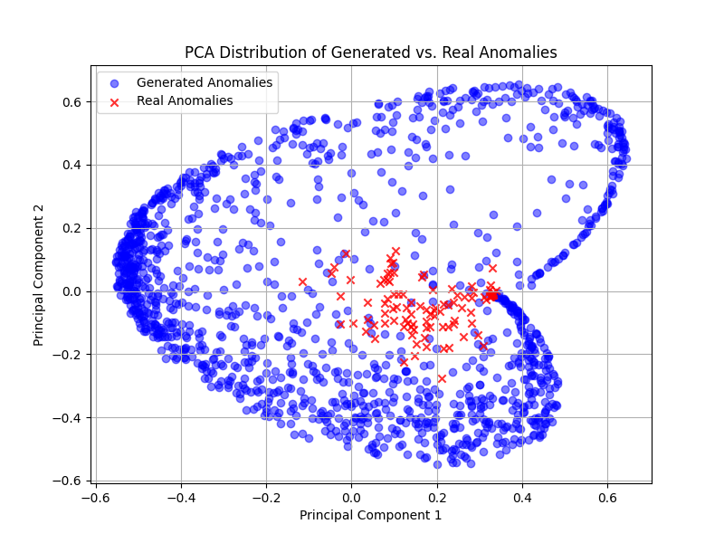
- **Augmentation vs. detection.** Despite its better sample quality, VAE-GAN improves CatBoost only
  marginally over VAE, so on small datasets a VAE may be sufficient.
- **Oversampling ratio.** 100% gives the best metrics but costs more compute. An adaptive ratio
  could balance efficiency and generalisation.
- **Expert validation.** The dataset is anonymised, so the SHAP explanations could not be checked
  by domain experts.
- **Online miss.** One anomaly was missed online, probably because CatBoost overfits a small
  dataset. More careful regularisation and tuning may help.
- **Next steps.** Diffusion models as generators, and deployment on other production lines to test
  generalisation.

## Citation

```bibtex
@mastersthesis{chen2025interpretable,
  title  = {An Interpretable Pipeline for Imbalanced Industrial Anomaly Detection:
            VAE-GAN Augmentation, CatBoost Classification, and TreeSHAP Interpretation},
  author = {Chen, Dong-Jun},
  school = {University of Bristol and University of the West of England},
  type   = {MSc Robotics Dissertation},
  year   = {2025},
  month  = aug
}
```

## License and acknowledgements

The code is released under the [MIT License](LICENSE). The UCI-SECOM dataset belongs to its
original authors and is distributed by the UCI Machine Learning Repository under CC BY 4.0.

Thanks to my supervisor **Carwyn Ward**, and to the School of Engineering Mathematics and
Technology (University of Bristol) and the School of Engineering (University of the West of England).

Key references: Kingma & Welling (VAE), Larsen et al. 2016 (VAE-GAN), Goodfellow et al. 2014 (GAN),
Prokhorenkova et al. 2018 (CatBoost), Lundberg & Lee 2017 and Lundberg et al. 2018 (SHAP / TreeSHAP).
See the dissertation for the full bibliography.
